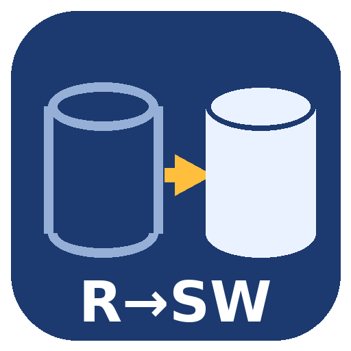

# rhino2sw

*Cleans up Rhino STEP exports for SolidWorks: rebuilds planar, cylindrical and conical B-spline faces as exact analytic geometry so mates and drawing dimensions work. Windows app with GUI; documentation in Italian.*

Rhino esporta tutte le facce come B-spline, compresi piani e fori: in SolidWorks mancano assi e piani
veri, quindi niente accoppiamenti concentrici e niente quote di diametro in tavola. `rhino2sw` riconosce
le facce che sono piani, cilindri e coni, le riscrive come geometria analitica **senza spostare la
geometria**, unisce le facce spezzate e controlla il risultato. Se un controllo fallisce il file non
viene scritto.



## Installazione (utenti)
Scaricare `rhino2sw-X.Y.Z-setup.exe` dalla pagina [Releases](https://github.com/erric0x5b/rhino2sw/releases)
e lanciarlo. Non servono diritti di amministratore né Python: l'installatore contiene tutto.
In alternativa c'è il pacchetto `-portatile.zip` da scompattare e usare senza installazione.

Istruzioni d'uso: [docs/GUIDA.md](docs/GUIDA.md).

> Windows SmartScreen può avvisare che l'app non è riconosciuta (l'eseguibile non è firmato):
> «Ulteriori informazioni» → «Esegui comunque».

## Cosa fa la finestra
- **Conversione**: si trascinano file o cartelle STEP (anche con sottocartelle), si preme *Converti*.
  Ogni file viene elaborato in un processo separato: un pezzo che manda in crash il motore geometrico
  non blocca gli altri. Doppio clic su una riga apre la cartella del file convertito.
- **Rapporti**: storico di tutte le conversioni da un unico CSV, con ricerca e filtro per esito.
- **Impostazioni**: dove salvare i file convertiti (accanto agli originali o cartella fissa), dove tenere
  il CSV dei rapporti (anche una cartella di rete condivisa per tutto l'ufficio), conversioni in parallelo.

## Controlli eseguiti su ogni pezzo
| Controllo | Soglia |
|---|---|
| Riconoscimento piano/cilindro/cono | 0,001 mm |
| Solido valido dopo la conversione | obbligatorio |
| Differenza di volume | ≤ 0,001 % |
| Scostamento massimo (punti campionati) | ≤ 0,005 mm |
| Spigoli con gap segnalati | > 0,001 mm |

## Sviluppo
```
python -m venv .venv && .venv\Scripts\activate
pip install -r requirements-build.txt
python run_rhino2sw.py                 # finestra
python -m rhino2sw --cli file.stp ...  # riga di comando
python tests/test_conversione.py       # test
pyinstaller rhino2sw.spec              # eseguibile in dist\rhino2sw
iscc /DAppVersion=0.2.0 installer\rhino2sw.iss   # installatore (Inno Setup 6)
```
Struttura:
- `rhino2sw/core.py` motore di conversione (OpenCASCADE via `cadquery-ocp`)
- `rhino2sw/gui.py` interfaccia PySide6
- `rhino2sw/report.py` CSV unico dei rapporti; `rhino2sw/settings.py` impostazioni utente
- `rhino2sw/__main__.py` ingresso: finestra, `--cli`, `--worker` (uso interno)
- `.github/workflows/build.yml` test + exe + installatore su ogni push; release sui tag `vX.Y.Z`

Per pubblicare una versione: aggiornare `__version__` in `rhino2sw/__init__.py`, `assets/version_info.txt`
e `CHANGELOG.md`, poi `git tag vX.Y.Z && git push --tags`.

`script_windows/` permette di avviare da sorgente su Windows senza l'installatore.

## Dati dei pezzi
Il `.gitignore` esclude tutti i file CAD (`.stp`, `.step`, `.x_t`, `.3dm`): i modelli reali non vanno nel
repository. Per i test usare solo pezzi generati da `tests/crea_pezzi_prova.py`.
Nelle issue non allegare modelli né percorsi di rete aziendali: bastano le colonne numeriche del rapporto.

## Limiti noti
Vedi le issue aperte. Principali: raccordi a toro lasciati B-spline, gap non ricuciti,
assiemi scritti come parte multicorpo, file multicorpo rifiutati interamente se un corpo fallisce.

## Licenza
MIT, vedi [`LICENSE`](LICENSE). Il motore geometrico è [Open CASCADE Technology](https://dev.opencascade.org/) (LGPL 2.1),
l'interfaccia usa [Qt for Python](https://doc.qt.io/qtforpython/) (LGPL 3).
